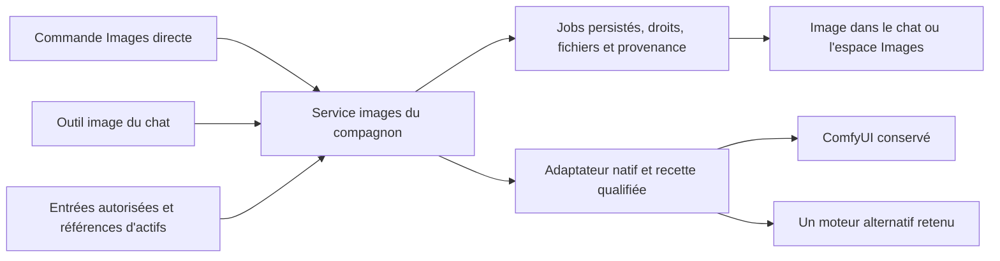

# Images locales : alternatives, intégration et roadmap regroupée

22 octobre 2026. **Exploration uniquement ; moteur alternatif proposé sous réserve de qualification.** Trois agents ont étudié les alternatives et l'intégration, puis les constats ont été revérifiés sur la version publiée. Aucun moteur installé, aucun poids téléchargé, aucun appel de génération et aucun changement de l'application.

Cette étude complète le [plan d'indépendance multi-moteurs](plan-independance-multi-moteurs.md) et la [comparaison Odysseus](comparaison-odysseus.md). Une livraison désigne ici une version fonctionnelle livrée à l'utilisateur ; elle peut regrouper plusieurs étapes de travail, tests et corrections internes.

**Base imposée pour les prochaines itérations : `main` publiée, version 2.0.0, commit `f47adbf44c863438aa2289bf676e7ac1f1ab054a`, identique à la cible du tag `v2.0.0`.** La livraison du fil d'intégration est terminée. Le [relevé de référence](reference-main-publiee.md) documente les écarts avec le dossier local 2.1.3 ; il fait autorité pour la reprise du développement.

## 1. Conclusion provisoire

La méthode recommandée est **interface du compagnon → service images commun → adaptateur natif du moteur**. Le choix du moteur ne doit pas décider du stockage des images, des permissions ou du fonctionnement du chat.

Les réponses utilisateur donnent la priorité aux **images fixes avec contrôle avancé, depuis une conversation qui prépare elle-même un prompt intéressant**, et à la réduction des manipulations côté utilisateur. Pour cette cible, la proposition devient **ComfyUI conservé + SD.Next comme premier moteur alternatif à qualifier**. `stable-diffusion.cpp / sd-server` reste une option légère à examiner, sans en faire le chemin critique des contrôles avancés. InvokeAI reste conditionnel au couple version/OS/GPU. Ce classement est une inférence de conception, pas un résultat de benchmark.

Une **livraison images unique est plausible**, après un contrôle ciblé du moteur retenu et avec un périmètre figé. La parité immédiate de toutes les fonctions de tous les logiciels ne l'est pas sur les preuves actuelles. Aucun remplacement des workflows actuels ni choix définitif de moteur n'est décidé.

## 2. Contraintes et questions ouvertes

La base publiée 2.0.0, relue au commit de référence, possède déjà le parcours conversation → outil image → job → image dans le chat. Elle utilise précisément :

- Krea 2 Turbo : `krea2_turbo_fp8_scaled.safetensors`, encodeur `qwen3vl_4b_fp8_scaled.safetensors` de type `krea2`, VAE `qwen_image_vae.safetensors`.
- HassakuXL Illustrious v34 : `hassakuXLIllustrious_v34.safetensors`.
- Deux LoRA par profil, leurs forces, trois formats, seeds, sorties conservées et nettoyage de fin de workflow.

Ces fichiers sont des références à préserver dans ComfyUI. Le support d'une famille de modèle ailleurs ne prouve pas celui de ce conditionnement FP8, de cet encodeur/VAE, des LoRA ou du checkpoint exact. Krea 2 n'est pas FLUX.1 Krea Dev. Un autre backend peut nécessiter une recette ou une quantification différente ; cela doit être proposé et testé, jamais substitué silencieusement.

L'utilisateur a confirmé sa machine **Windows/Radeon RX 7800 XT 16 Go et 32 Go de RAM**. Le dépôt vise aussi ses proches, dont une configuration NVIDIA RTX 5070 / CPU Ryzen 7800X3D, et des configurations inconnues. Les profils AMD/NVIDIA et les erreurs d'installation doivent être indépendants ; aucun réglage de cette Radeon ne doit devenir un défaut universel. Cette confirmation ne qualifie pas une version précise de ROCm, Vulkan, CUDA, pilote ou poids sur ces machines.

Décisions utilisateur reçues :

| Décision | Conséquence |
| --- | --- |
| Images fixes avec contrôle avancé et génération depuis la conversation | Préparer le prompt avec le modèle de chat déjà choisi ; exposer contrôles et références selon la recette. |
| Une nouvelle installation est possible si le gain est clair | Autorise l'étude d'un second moteur ; ne déclenche aucune installation automatique. |
| Minimiser surtout réglages et essais côté utilisateur | L'équipe prend en charge qualification et recettes ; une livraison regroupée est préférable à plusieurs connecteurs expérimentaux. |
| Machine AMD confirmée ; public aussi NVIDIA et inconnu | Diagnostic par environnement et moteur, sans promesse universelle GPU ni réglage matériel codé en dur. |
| Images multi-moteurs d'abord, compatibles avec le plan général | Ne pas attendre ni inclure automatiquement la migration complète des projets et des moteurs texte. |
| La version publiée de main est la base de travail | Repartir de la 2.0.0 publiée, en préservant ses correctifs et tests ; ne pas réutiliser en bloc le dossier local. |

Précisions reçues ensuite : **références et LoRA prioritaires dès D1 ; retouche différée**. Les recettes exactes Krea2/Hassaku restent sur ComfyUI ; le second moteur peut proposer ses propres recettes qualifiées. Il n'est donc pas nécessaire de porter nos FP8 exacts sur SD.Next ou sd.cpp pour fermer D1. Le démarrage assisté des serveurs sera défini dans le parcours d'installation ; aucune installation n'est engagée par cette étude.

## 3. Alternatives réellement différentes

| Solution | Ce que les sources établissent | Réserve pour notre installation | Position exploratoire |
| --- | --- | --- | --- |
| **ComfyUI existant** | Recettes explicites, service déjà intégré, jobs suivis et sorties copiées par le compagnon. | Dépendance aux nœuds/modèles de chaque profil ; graphe API non universel. | Référence et compatibilité à conserver. |
| **stable-diffusion.cpp / sd-server** | Serveur C/C++, Windows et Vulkan documentés ; API native asynchrone, catalogues/recettes et LoRA structurés. Vrai Krea2 documenté. [S1], [S2], [S3] | Fonctionnalités de la branche consultée à retrouver dans un binaire figé ; poids exacts, opérateurs et contrôles à vérifier. | Option légère, hors chemin critique des contrôles avancés de D1. |
| **SD.Next** | API publique, génération/édition/contrôle et modèles récents dont Krea2 ; voies AMD Windows documentées. [S4], [S5], [S6] | Requête classique longue et interruption générale ; historique/scheduler et GPU à qualifier selon version. | Premier second moteur proposé pour l'usage avancé confirmé. |
| **InvokeAI** | Queue native, modèle de workflow, gestion images/modèles et outils de création. Krea2 est documenté. [S7], [S8], [S9] | Stable 6.14.2 et branche v7 alpha n'ont pas le même support AMD Windows ; workflow distinct de ComfyUI. | Bon candidat conditionnel au couple OS/version/GPU retenu. |
| **Forge Neo** | Branche `neo` du dépôt Forge Classic, API WebUI et vrai Krea2 annoncés, réutilisation possible des chemins Comfy. [S10] | Guide AMD externe et support matériel à qualifier ; suivi/arrêt ne doivent pas être supposés équivalents à un job durable. | Réserve pertinente si déjà utilisé ou nettement meilleur sur les modèles demandés. |
| **AUTOMATIC1111 / famille WebUI** | API txt2img/img2img et extensions, largement documentée. [S11] | Contrats d'extensions, versions et modèles récents variables ; synchronisme et état partagé. | Compatibilité opportuniste, pas premier chantier distinct. |
| **SwarmUI** | API de haut niveau, catalogue et génération avec progression ; vrai Krea2 documenté. [S12], [S13] | Le chemin standard utilise un backend ComfyUI. Ce n'est donc pas une diversification du moteur dans ce cas. | Source d'inspiration UX ; adaptateur seulement s'il existe déjà un besoin Swarm. |
| **LocalAI** | Serveur multi-familles avec API images et backends C++/Diffusers. [S14] | Couche d'orchestration supplémentaire devant des moteurs que le compagnon peut appeler directement. | À privilégier seulement si LocalAI devient aussi une infrastructure déjà choisie. |
| **Diffusers + serveur sur mesure** | Pipelines programmables et exemple FastAPI. [S15] | Nous entretenons dépendances GPU, jobs, annulation, modèles et service Python ; l'exemple ne fournit pas tout cela. | Maximum de contrôle, coût supérieur pour une première livraison. |
| **SGLang Diffusion** | Déploiement Krea2 natif et API images documentés par SGLang, référencé par Krea. [S16], [S17] | Configuration et mémoire à qualifier ; pas de preuve ici pour notre RX 7800 XT sous Windows ou pour nos FP8 exacts. | Piste serveur/Linux ou autre matériel ; pas une obligation de la première livraison. |

Ce tableau compare des logiciels et des contrats, pas la qualité des images à paramètres différents. Aucun score chiffré de vitesse, de fiabilité ou de facilité n'est attribué sans mesure.

### Points qui changent la décision

**stable-diffusion.cpp.** L'API native documente soumission avec identifiant, suivi et annulation ; sa compatibilité OpenAI images reste synchrone. Il faut choisir le contrat natif pour notre service de jobs. Une API asynchrone n'établit cependant ni persistance du serveur après redémarrage, ni idempotence de soumission. Le guide Krea2 consulté nomme un VAE Wan2.1, différent du nom Qwen-Image du workflow actuel : cela impose une vérification, sans déduire équivalence ou incompatibilité des seuls noms. [S1], [S3]

**SD.Next.** Les routes publiques `/sdapi/` et les schémas de l'instance font référence. L'API classique renvoie les images à la fin du calcul ; progression et historique existent, mais le nouveau scheduler ne doit pas être assimilé sans essai au cycle ComfyUI. Un adaptateur peut maintenir cette requête dans un worker serveur et exposer notre propre job à l'interface. Après perte du résultat, l'état peut rester inconnu. [S4]

**InvokeAI.** Au relevé, le tag stable `v6.14.2` déclare la version 6.14.2 et documente AMD sous Linux ; `main` déclare `7.0.0-alpha.3-post1` et des exigences Windows/Linux ROCm 10. Il faut choisir explicitement version et environnement, plutôt qu'opposer deux guides de générations différentes. Le support Krea2 est réel au niveau famille, pas une qualification de nos fichiers exacts. [S7], [S8], [S9]

**Retouche et modèle.** Changer d'interface ne donne pas de nouvelles modalités à un checkpoint. La documentation SGLang présente les variantes publiques Krea2 comme texte-vers-image et dirige les usages d'édition vers d'autres pipelines. Un moteur peut offrir img2img/inpainting pour certains modèles sans le faire pour tous. Le compagnon doit afficher la capacité de la recette sélectionnée. [S16]

## 4. Meilleure méthode d'intégration proposée

### Un service images appartenant au compagnon

Le service commun reprend ce qui existe dans `lib/comfy-images.mjs` : intention enregistrée avant envoi, propriétaire, identifiant de requête, suivi, état inconnu, sortie copiée, contrôle du format et empreinte. L'adaptateur ne conserve que protocole, encodage des entrées, recette et traduction des états.

La génération directe et l'outil du modèle appellent **le même service**, avec les mêmes droits. Cela évite que la création d'image dépende toujours d'un LLM capable d'appels d'outils. Une génération directe ne doit pas nécessiter un faux message d'assistant : son rattachement à un projet ou espace de génération est explicite.

### Parcours prioritaire : demande simple → prompt préparé → image

Exemple utilisateur : « Génère une image d'une maison dans une clairière fleurie. »

1. Le modèle de conversation déjà sélectionné conserve maison, clairière, fleurs et les éventuelles références. Il enrichit composition, lumière, matières ou ambiance dans les limites de cette demande ; aucun serveur de texte supplémentaire n'est nécessaire.
2. Il prépare directement l'appel structuré de génération, adapté au profil moteur/modèle : prompt final, rôle des références autorisées et seules options disponibles. Les réglages techniques validés du profil restent côté compagnon ; aucun nom de poids ou chemin n'est inventé.
3. Le serveur valide puis fige connexion, recette, paramètres et actifs. L'autorisation Images du message reste distincte de celles des fichiers, du web et des scripts.
4. Le compagnon affiche le job et ensuite l'image, avec demande originale, prompt final, modèle et paramètres consultables. Il ne demande pas de recopier le prompt dans une autre application.

Prévoir deux modes lisibles : **Enrichir la demande** pour le parcours conversationnel souhaité, et **Prompt exact** lorsque l'utilisateur fournit déjà son texte. L'enrichissement n'ajoute pas silencieusement un autre sujet, du texte à afficher ou une identité de référence. Les conventions HassakuXL et Krea2, les prompts négatifs et le traitement des références appartiennent à leurs recettes ; aucun préréglage universel ne s'applique à tous les modèles.

Dans la main publiée, le schéma actuel exige déjà un prompt anglais fidèle et interdit les ajouts arbitraires ; le delta est une politique explicite de mise en scène contrôlée. Les arguments actuels se limitent à prompt/format/seed : images sources, masque, pose et références typées doivent être ajoutés, pas simplement annoncés dans le texte des consignes.

La boucle courante rappelle le modèle après tout résultat d'outil. Pour un tour explicitement consacré à créer une image, terminer après soumission confirmée avec un accusé serveur déterministe et la carte de suivi évite un second appel LLM systématique. Garder la boucle habituelle pour une demande mixte nécessitant d'autres actions. Arrêter l'appel ne prouve pas que les poids du modèle texte ont quitté la VRAM.

### Contrat commun réduit

| Responsabilité | À prévoir |
| --- | --- |
| Découverte | Version, capacités par recette, catalogue modèles/LoRA, limites et date de contrôle. |
| Validation | Sélection utilisateur figée : connexion, recette/version, modèle, paramètres et entrées autorisées. |
| Soumission | Un job local, puis un identifiant distant ou un résultat synchrone ; aucune répétition automatique ambiguë. |
| Suivi | États communs et progression seulement si attribuable à ce job ; reprise selon garanties réelles du moteur. |
| Arrêt | Distinguer demande d'annulation, arrêt confirmé, arrêt global et fonction indisponible. |
| Collecte | Récupérer les octets, contrôler format/taille/dimensions, copie privée et provenance. |

L'interface expose **connexion → recette/modèle → paramètres disponibles**. Les options spécialisées restent dans un volet avancé propre au profil. Ni un graphe ComfyUI ni toutes les options WebUI ne deviennent un schéma universel. L'outil du chat reçoit une liste de paramètres bornés et des références d'actifs ; il ne choisit pas une URL, un chemin local ou du code exécutable.

Le parcours ordinaire choisit un moteur connecté et un préréglage lisible, puis la demande. LoRA, seed, dimensions, image initiale, référence de style, image de contrôle et masque lié à sa source restent dans les options avancées correspondant au profil. Les catalogues et tests de connexion sont récupérés par le compagnon ; aucun choix de modèle absent n'est proposé comme prêt.

Les images sources et masques passent par les imports/fichiers autorisés existants, puis multipart, base64 ou upload natif selon l'adaptateur. Les résultats sont servis par les routes authentifiées du compagnon ; aucune clé moteur ou URL localhost inutilisable n'est envoyée au téléphone. Les anciens outils et routes ComfyUI restent compatibles pendant la migration.

Pour D1, distinguer **référence analysée pour préparer le prompt** et **référence conditionnant réellement le rendu**. Le premier chemin requiert un modèle de conversation vision compatible et ne garantit pas pose, identité ou composition. Le second exige une recette qualifiée avec un mécanisme de conditionnement compatible, par exemple un adaptateur de référence SDXL ou un modèle offrant cette modalité. Ne pas envoyer une référence à un profil texte-seul en laissant croire qu'elle est utilisée. Les deux graphes ComfyUI livrés ne comportent aujourd'hui aucune entrée de référence ; il faut donc qualifier au moins une recette guidée supplémentaire pour annoncer cette fonction. L'interface conserve le rôle de la référence et indique ce qui a réellement été transmis.

Le conditionnement du moteur peut utiliser un actif autorisé même si le LLM de conversation n'est pas vision : il reçoit alors une référence identifiée et son rôle, sans prétendre avoir examiné ses pixels. Les contraintes LoRA, leur format et leurs plages de force sont propres au profil ; la plage historique ComfyUI n'est pas appliquée arbitrairement à tous les moteurs.

### Pourquoi l'API native est prioritaire

| Moteur | Chemin de génération à examiner | Conséquence pour le compagnon |
| --- | --- | --- |
| ComfyUI | `/prompt`, `/history/{prompt_id}`, `/queue`, `/view` | Adapter le service actuel, conserver ses garanties et limites. |
| sd-server | `POST /sdcpp/v1/img_gen`, `GET /sdcpp/v1/jobs/{id}`, `POST /sdcpp/v1/jobs/{id}/cancel` | API native plus proche de nos jobs que le seul `/v1/images/generations`. [S1] |
| InvokeAI stable | `POST /api/v1/queue/default/enqueue_batch`, item de queue et annulation ciblée, images `/api/v1/images/i/{name}/full` ; catalogue `/api/v2/models/` | Convertir une recette en graphe Invoke ; qualifier la reprise et les sorties. [S8] |
| SD.Next / WebUI | Routes `/sdapi/v1/txt2img`, `/img2img` et contrats propres de chaque version | Worker conservant la requête longue ; ne pas présenter une progression globale comme spécifique à notre job. [S4], [S11] |

Une façade OpenAI images peut être ajoutée ultérieurement pour des serveurs simples. Elle ne doit pas faire perdre catalogues, LoRA structurés, suivi, annulation ciblée ou état de chargement lorsqu'une API native les expose.

### Mémoire, concurrence et incidents

- Un groupe matériel explicite relie les connexions qui partagent un GPU. Pour le moteur image retenu, commencer par un seul rendu actif dans ce groupe ; le traitement des demandes texte dépend de la politique de coexistence choisie.
- Ne pas confondre file sérialisée et VRAM libérée : un LLM peut rester chargé. Aucun déchargement ou arrêt d'un modèle externe n'est déduit d'un timeout.
- Ne pas interrompre globalement un moteur partagé sans avoir établi que le job actif est le nôtre et que cette portée est autorisée. Sinon, annoncer l'absence d'annulation isolée.
- Conserver `cancel_requested` distinct de `cancelled`. La fin d'une connexion du navigateur n'arrête pas la génération serveur ; le redémarrage de ce serveur ne prouve pas que le moteur a perdu son travail.
- Copier les sorties réussies dans le compagnon. Désactiver une connexion ne supprime ni images ni provenance ; un rendu inconnu ne doit pas être rejoué automatiquement.
- Pour les nouvelles recettes, la comparaison à seed fixe est utile mais ne garantit pas un pixel identique entre moteurs, samplers, versions ou quantifications.

## 5. Roadmap avec une seule livraison fonctionnelle

### Étape exploratoire et contrôle de faisabilité — aucune version utilisateur

1. Appliquer le périmètre confirmé : images fixes, références et LoRA, préparation conversationnelle, retouche différée ; recettes Krea2/Hassaku conservées sur ComfyUI.
2. Retenir un seul candidat alternatif et figer sa version/API/binaire. Vérifier que les fonctions de documentation figurent réellement dans cette version ; une page `master` ne le prouve pas.
3. Préparer une matrice courte de recettes et capacités. Lors d'une validation ultérieure choisie, contrôler un rendu réellement prioritaire, ses LoRA/entrées si requis, collecte, arrêt, panne et cohabitation mémoire. Ces essais n'ont pas été exécutés par cette étude.
4. Décider une fois : candidat retenu, périmètre fermé, éléments restant ComfyUI et critères d'acceptation. Si un critère essentiel échoue, changer le choix avant l'intégration ; ne pas livrer successivement plusieurs connecteurs inachevés.

### D1 — Une livraison images regroupée

| Travail interne | Résultat attendu dans la même livraison |
| --- | --- |
| Repartir de main publiée | Révision de base contrôlée, correctifs d'installation/autoupdate et réglages des tokens conservés ; travaux locaux séparés. |
| Extraire service/stockage/adaptateurs | Jobs et actifs neutres, adaptateur ComfyUI inchangé fonctionnellement, SD.Next proposé sous réserve de qualification. |
| Migrer sans réécriture destructive | Anciennes images, jobs, LoRA, reçus et propriétaires lisibles ; alias des outils/routes conservés. |
| Unifier le parcours | Demande conversationnelle et prompt préparé, choix simple connexion/recette, paramètres avancés conditionnels et génération directe. |
| Rendre l'exploitation lisible | Diagnostic sans rendu, erreur par service, progression honnête, annulation selon portée et mémoire explicite. |
| Qualifier avant livraison | Scénarios de panne/reprise, permissions, copies, installation, téléphone et profils AMD/NVIDIA réellement essayés ; configurations non essayées annoncées. |

D1 couvre le moteur alternatif qualifié, ses catalogues et LoRA, ainsi qu'au moins une recette qualifiée dont la référence conditionne réellement le rendu, sur ComfyUI ou sur ce moteur. D1 doit en rendre le fonctionnement explicite, sans exiger la même modalité de chaque profil. Une analyse vision transformée en prompt peut compléter le parcours, mais ne suffit pas à qualifier la génération guidée par référence. Retouche, masques/inpainting, contrôle de pose dédié et upscale restent hors du périmètre initial, sauf élément strictement nécessaire à cette recette. Vidéo, canvas complet, tous les forks WebUI, import libre de graphes et installation automatique des moteurs ne sont pas inclus. L'absence de parité entre moteurs ne retire aucune fonction aux profils ComfyUI conservés.

**Conclusion sur une seule itération.** Une seule livraison D1 est cohérente avec ce périmètre. Cela ne signifie ni un seul essai, ni absence de corrections, ni installation de tous les moteurs. Le court contrôle de faisabilité évite précisément que l'implémentation serve à découvrir une incompatibilité GPU ou de poids essentielle.

### Périmètre confirmé et variante écartée pour D1

L'utilisateur a retenu **images multi-moteurs d'abord**, compatibles avec le plan général. Les lots L0–L6 décrivent des travaux, pas sept versions à publier, mais ils ne sont pas tous inclus dans D1. Une livraison globale cumulerait stockage de projets, schémas, moteurs texte, images, UI, installation et retour arrière ; elle n'est pas le périmètre de cette première livraison.

La livraison images sur le socle publié ne supprime donc pas à elle seule toute dépendance du catalogue de projets à Bionic. Ses identités de connexions, recettes, jobs et actifs sont conçues pour être reprises par le futur socle autonome, sans deuxième migration gratuite.

### Critères pour fermer D1

1. Anciennes conversations, images, jobs et réglages ComfyUI conservés ; aucune fonction existante supprimée pour uniformiser les moteurs.
2. Le moteur alternatif a un rendu réel qualifié sur la configuration retenue, avec les modèles et modalités annoncés ; au moins une recette qualifiée de D1 transmet effectivement la référence au mécanisme qui conditionne le rendu.
3. Commande directe et outil de chat passent par les mêmes droits, entrées autorisées et service ; l'indisponibilité du modèle texte n'empêche pas le parcours direct dans le périmètre prévu.
4. Une demande produit au plus une soumission automatique ; interruption, résultat perdu et état inconnu ne provoquent aucun doublon.
5. Reconnexion, redémarrage, arrêt demandé/confirmé et moteur partagé sont représentés honnêtement.
6. Sorties récupérées, vérifiées, conservées et téléchargeables depuis le téléphone ; provenance du moteur et de la recette visible.
7. Installation reproductible, sauvegarde, compatibilité des schémas et procédure de retour arrière documentées.
8. La garde de mise à jour bloque une installation pendant les jobs images de tous les adaptateurs, comme elle le fait déjà pour ComfyUI sur main. Le curseur/plafond des tokens et les correctifs Windows publiés restent couverts.

## 6. Sources et limites

Sources primaires consultées le 22 octobre 2026 ; les branches et documentations non taguées restent mouvantes. Les trois rapports d'agents sont synthétisés, leurs préférences locales ne constituent pas trois votes indépendants sur un même ensemble de critères.

[S1]: https://github.com/leejet/stable-diffusion.cpp/blob/master/examples/server/api.md
[S2]: https://github.com/leejet/stable-diffusion.cpp/blob/master/docs/build.md
[S3]: https://github.com/leejet/stable-diffusion.cpp/blob/master/docs/krea2.md
[S4]: https://github.com/vladmandic/sdnext/wiki/API
[S5]: https://github.com/vladmandic/sdnext
[S6]: https://vladmandic.github.io/sdnext-docs/CHANGELOG/
[S7]: https://github.com/invoke-ai/InvokeAI/blob/v6.14.2/docs/src/content/docs/start-here/system-requirements.mdx
[S8]: https://github.com/invoke-ai/InvokeAI/blob/v6.14.2/invokeai/app/api/routers/session_queue.py
[S9]: https://invoke.ai/features/krea-2/
[S10]: https://github.com/Haoming02/sd-webui-forge-classic/tree/neo
[S11]: https://github.com/AUTOMATIC1111/stable-diffusion-webui/wiki/API
[S12]: https://github.com/mcmonkeyprojects/SwarmUI/blob/master/docs/API.md
[S13]: https://github.com/mcmonkeyprojects/SwarmUI/blob/master/src/BuiltinExtensions/ComfyUIBackend/README.md
[S14]: https://localai.io/docs/features/image-generation/
[S15]: https://huggingface.co/docs/diffusers/main/en/using-diffusers/create_a_server
[S16]: https://docs.sglang.io/cookbook/diffusion/Krea/Krea-2
[S17]: https://github.com/krea-ai/krea-2

Références complémentaires pour figer le choix : [version stable Invoke](https://github.com/invoke-ai/InvokeAI/blob/v6.14.2/invokeai/version/invokeai_version.py), [version de développement](https://github.com/invoke-ai/InvokeAI/blob/main/invokeai/version/invokeai_version.py), [exigences de développement](https://github.com/invoke-ai/InvokeAI/blob/main/docs/src/content/docs/start-here/system-requirements.mdx), [catalogue modèles Invoke v2](https://github.com/invoke-ai/InvokeAI/blob/v6.14.2/invokeai/app/api/routers/model_manager.py), [images Invoke](https://github.com/invoke-ai/InvokeAI/blob/v6.14.2/invokeai/app/api/routers/images.py), [API Neo](https://github.com/Haoming02/sd-webui-forge-classic/blob/neo/modules/api/api.py).

Les sources locales examinées sont `server.mjs`, `lib/agent-tools.mjs`, `lib/comfy-images.mjs`, `public/comfy-images.js`, les deux graphes de `workflows/`, la documentation ComfyUI et le plan courant. Les détails d'architecture ci-dessus restent des propositions à spécifier après le choix.

Le recalage final utilise les [sources publiées au commit f47adbf](https://github.com/Shaft1942/bionic_local_server/tree/f47adbf44c863438aa2289bf676e7ac1f1ab054a), en particulier [consignes et boucle de génération](https://github.com/Shaft1942/bionic_local_server/blob/f47adbf44c863438aa2289bf676e7ac1f1ab054a/server.mjs#L378), [schéma des outils](https://github.com/Shaft1942/bionic_local_server/blob/f47adbf44c863438aa2289bf676e7ac1f1ab054a/lib/agent-tools.mjs#L13) et [service images existant](https://github.com/Shaft1942/bionic_local_server/blob/f47adbf44c863438aa2289bf676e7ac1f1ab054a/lib/comfy-images.mjs). La base locale a servi à la première exploration, pas de base implicite de développement.
