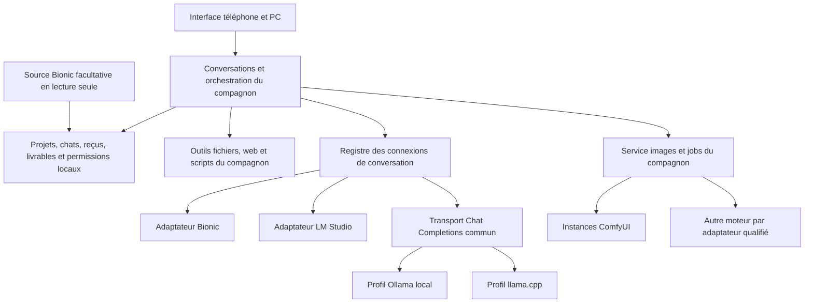

# Plan d'indépendance de Bionic et de prise en charge de plusieurs moteurs

Date : 22 octobre 2026. Statut : proposition de migration, sans modification du fonctionnement de l'application.

**Décision du 24 octobre 2026 : llama.cpp / `llama-server` est le premier candidat texte à qualifier**, avant LM Studio et Ollama. Réutiliser les GGUF compatibles depuis leurs emplacements existants, sans déplacement ni duplication imposée. L'accès aux fichiers ne vaut pas compatibilité : les poids et composants Krea2 restent exécutés par ComfyUI dans le périmètre retenu. Le compagnon orchestrera conversation et images ; aucune compatibilité locale nouvelle n'est encore démontrée. Cette décision fixe l'ordre des essais, sans retirer les autres cibles ni changer les dépendances L0–L6.

Complément du même jour : comparaison Odysseus par trois agents, recoupée avec les sources officielles et intégrée aux lots ci-dessous. Voir l'[étude comparative et ses références](comparaison-odysseus.md) et les décisions O01–O12 en section 14.

**Recalage utilisateur : les prochaines itérations partent de `main` publiée, version 2.0.0, commit `f47adbf44c863438aa2289bf676e7ac1f1ab054a`, cible du tag `v2.0.0`.** Voir le [relevé vérifié](reference-main-publiee.md). La première livraison vise les images multi-moteurs, avec références, LoRA et prompt préparé depuis le chat ; elle reste compatible avec le futur socle indépendant sans l'inclure entièrement. Voir section 15 et l'[exploration des moteurs images](exploration-moteurs-images-locaux.md).

Architecture visée : le compagnon possède ses projets, conversations, fichiers de configuration et outils. Bionic devient un connecteur facultatif parmi les moteurs de conversation et une source facultative d'historiques. ComfyUI reste un service de génération par workflows, utilisable avec les différents moteurs de conversation.

## 1. Point de départ vérifié

La première lecture a porté sur un dossier local déclarant **2.1.3**, avec changements indexés et non indexés. La comparaison avec GitHub montre que la base publiée **2.0.0** contient déjà ses fonctions images centrales, ainsi que des correctifs absents du dossier local : garde d'autoupdate pendant les jobs, curseur de tokens, installation et reprise des renommages Windows. Le numéro local ne définit donc pas la base de développement. L'implémentation partira d'un espace dédié issu de la main publiée retenue, sans écraser le travail en cours.

Constats issus de la lecture des sources :

| Dépendance actuelle | Où elle apparaît | Conséquence pour la migration |
| --- | --- | --- |
| Un seul serveur de conversation et un jeton global | `lib/config.mjs`, `server.mjs` | Remplacer par des connexions identifiées, chacune avec sa configuration privée. |
| Génération appelée directement sur `/v1/chat/completions` | `server.mjs`, `consumeModelStream` dans `lib/file-agent.mjs` | Extraire transport, traduction des paramètres et lecture du flux dans des connecteurs. |
| Modèles et déchargement au format REST Bionic/LM Studio | `lib/model-service.mjs`, `lib/diagnostics.mjs` | Le protocole de conversation commun ne suffit pas pour la gestion mémoire et les capacités. |
| Catalogue de projets issu du registre Bionic | `lib/bionic-store.mjs`, `lib/conversation-organizer.mjs` | Sans ce registre, même les conversations du compagnon peuvent devenir inaccessibles. |
| Racines de fichiers relues dans le registre Bionic | `lib/project-files.mjs` | Créer une autorité locale pour les dossiers et leurs permissions. |
| Préférences et effort indexés par le seul identifiant de modèle | `lib/model-preferences.mjs`, `server.mjs`, `public/app.js` | Deux moteurs proposant le même nom risquent de partager des réglages par erreur. |
| ComfyUI dispose déjà d'un service distinct et de jobs persistés | `lib/comfy-images.mjs`, `lib/comfy-settings.mjs`, `lib/comfy-loras.mjs` | Étendre ce socle en préservant les jobs, images et recettes existants. |
| Installation et mise à jour connaissent l'identité Bionic du produit | Scripts Windows, `lib/update-installer.mjs`, `lib/update-service.mjs` | Séparer l'indépendance technique d'un éventuel changement de nom ou de dépôt. |

Les registres de validation antérieurs restent des preuves historiques. Cette préparation n'a relancé ni suite de tests, ni modèle, ni rendu, et ne confirme aucune compatibilité nouvelle sur la machine.

## 2. Résultat attendu et périmètre

Une installation neuve doit démarrer sans Bionic installé, sans son dossier de données et sans son API. Elle doit permettre de créer un projet et un chat, gérer les fichiers et livrables, puis connecter un moteur de conversation et/ou ComfyUI.

Une installation existante doit retrouver ses données et ses réglages. Bionic continue de fonctionner par son connecteur et ses historiques restent en lecture seule. Le changement de moteur ne déplace pas les fichiers ni les conversations.

Périmètre du futur socle autonome, distinct de la livraison images D1 :

- Bionic conservé ; LM Studio, Ollama local et `llama-server` de llama.cpp comme cibles supplémentaires.
- Plusieurs connexions enregistrées et utilisables dans des conversations différentes ; changement explicite de moteur dans un même chat pour les messages suivants.
- ComfyUI facultatif, d'abord avec l'instance et les deux workflows actuels ; prise en charge de plusieurs instances ensuite dans le même chantier.
- Connexions locales par défaut. Le LAN privé pour les moteurs de texte sera une option explicite avec règles d'adresse, délais et secrets équivalentes au service ComfyUI actuel.
- Connecteur générique pour API compatibles avec Chat Completions, sans promettre toutes les fonctions sur tous les serveurs.
- Parcours initial sans modèle connecté, diagnostics indépendants par service et export portable versionné sans secrets. Comparaison de modèles et notes de projet restent des extensions ; la génération directe est désormais proposée dans D1 images, selon la section 15.

vLLM, moteurs cloud, audio/vidéo, téléchargement automatique de modèles, import libre de workflows tiers, héritage des MCP/skills Desktop et synchronisation native bidirectionnelle ne sont pas requis pour cette première livraison. Les ajouter ne doit pas être nécessaire pour déclarer l'indépendance de Bionic.

« Conserver les fonctions » signifie maintenir les fonctions du compagnon et celles du connecteur Bionic. Les options dépendantes d'un moteur ou d'un modèle restent accessibles lorsqu'elles sont prises en charge ; une fonction indisponible est expliquée, jamais simulée.

## 3. Architecture cible



Trois contrats distincts évitent de confondre un moteur avec toute l'application :

1. **Connexion d'inférence** : modèles, génération, capacités, paramètres et gestion mémoire lorsqu'elle existe.
2. **Source d'historiques** : consultation et copie explicite d'historiques externes ; aucune dépendance pour ouvrir les chats locaux.
3. **Service de workflows images** : profils, soumission, suivi et récupération des sorties ComfyUI.

Les outils et leurs autorisations restent dans le compagnon. Les connecteurs ne récupèrent pas automatiquement les outils, comptes ou permissions de l'application distante. Les adaptateurs sont du code livré avec le projet ; aucun système de plugins exécutables téléchargés à la volée n'est nécessaire.

## 4. Projets et données indépendants

Créer un registre privé versionné, par exemple `data/projects.json`, et un service `lib/project-store.mjs`. Un projet contient un identifiant stable, son nom, son dossier principal facultatif, les dossiers liés avec leurs droits et, si nécessaire, une référence à sa source Bionic.

Le catalogue local devient l'autorité pour les chats, livrables, corbeilles et accès fichiers. Il permet de créer, renommer et archiver des projets sans Bionic. Archiver ne supprime aucun dossier de travail. « Sans projet » reste utilisable sans droit implicite sur un dossier.

Pour une installation existante :

- Prévisualiser les projets détectés, les dossiers et les droits avant leur adoption dans le registre local.
- Conserver les identifiants actuels lorsque possible ; employer une table d'alias pour les collisions, plutôt qu'un changement massif d'identifiants.
- Conserver aussi les identifiants des racines liées (`linked-<index>` aujourd'hui), ou fournir leurs alias : réordonner les dossiers ne doit pas rediriger une ancienne pièce jointe vers une autre racine. Les sources externes reçoivent une référence structurée `{sourceId, externalProjectId, externalConversationId}` pour éviter les collisions futures.
- Distinguer dossier interne d'une application, dossier de travail et dossiers liés. Ne pas transformer le dossier interne Bionic en racine de fichiers autorisée.
- Respecter la séparation actuelle : les outils directs du modèle visent le dossier principal ; les dossiers supplémentaires et liés gardent leurs droits propres dans l'explorateur manuel. Un ajout de racine n'élargit pas automatiquement le périmètre des outils du modèle.
- Enregistrer les droits adoptés explicitement. Une modification ultérieure du registre Bionic produit une proposition de mise à jour, jamais un élargissement automatique des permissions.
- Une source Bionic absente ou illisible ne bloque ni les projets locaux ni les chats du compagnon. Les erreurs de cette source apparaissent comme un inventaire partiel.
- Garder la lecture native dans `lib/bionic-store.mjs`. Pour rendre un historique consultable après retrait de Bionic, proposer une copie locale explicite de ses messages et pièces jointes récupérables, avec provenance, omissions et limite de taille visibles.

Une référence à un historique externe n'est pas une sauvegarde de cet historique. Ce point doit être explicite lors de la désactivation de la source.

Définir un export portable versionné : projets, chats, provenance, messages, pièces jointes récupérables, livrables, alias et empreintes, avec rapport des omissions et références de moteurs non résolues. Il exclut secrets, sessions, accords actifs et droits réutilisables sur des chemins. L'import propose un aperçu et une réadoption explicite des dossiers/connexions. La sauvegarde privée complète reste un autre format et un autre usage. Un export JSON ne prouve pas la compatibilité avec l'import d'Odysseus ou d'un autre produit.

## 5. Contrat des moteurs et identité des modèles

Créer un registre privé de connexions, par exemple `data/providers.json`, avec un `providerId` stable par connexion. Deux serveurs du même logiciel ont deux identités différentes. Le type d'adaptateur est distinct de cette identité.

Référence de modèle proposée :

```json
{
  "providerId": "pc-ollama",
  "modelId": "modele-retourne-par-le-serveur",
  "instanceId": null
}
```

L'instance chargée est enregistrée lorsqu'elle est connue et utile. Les préférences durables sont indexées par le couple connexion/modèle ; l'identité d'une instance éphémère ne doit pas les effacer au rechargement.

Préférer un objet structuré ou un encodage canonique pour cette clé. Ne pas concaténer naïvement des identifiants avec un séparateur qui peut aussi appartenir à un nom de modèle. Réviser les validateurs, les brouillons, les préférences et les reçus concernés sans casser leurs anciennes clés.

Contrat interne proposé :

| Opération | Résultat attendu |
| --- | --- |
| `probe()` | Joignabilité, authentification, version lorsqu'exposée, sans génération. |
| `listModels()` | Identifiants et noms, capacités sourcées, contexte et instances lorsqu'ils sont connus. |
| `generate(request, signal)` | Événements normalisés : texte, raisonnement distinct si transmis, fragments d'appels d'outils, usage, fin et erreur. |
| `modelManagement` facultatif | Liste des instances, chargement ou déchargement seulement si l'adaptateur expose et vérifie l'opération. |
| `normalizeOptions()` | Conversion des plafonds, effort et paramètres vers le contrat exact de ce serveur. |

Le noyau reste responsable du contexte, des limites d'actions, des autorisations, de l'exécution des outils et de la persistance. Les adaptateurs traduisent le protocole ; ils n'exécutent pas les outils à sa place.

Règles de comportement :

- Capacités à trois états : pris en charge, indisponible, inconnu. Conserver la distinction entre déclaration d'API, configuration utilisateur et essai réel avec un modèle/version donnés.
- Associer à chaque preuve sa source, sa portée connexion/modèle/instance, sa date, la révision de connexion et les versions/template connus. Revalider après changement pertinent ; ne pas effacer une contradiction entre déclaration et essai. Un timeout signifie service non vérifié, pas capacité absente. Un choix manuel visible ne donne aucune autorisation supplémentaire.
- Ne pas transformer une capacité inconnue en `true`, notamment pour les appels d'outils. Un essai explicite peut établir une capacité pour une combinaison donnée.
- Séparer support de transport et aptitude du modèle : une route acceptant `tools` ne prouve pas que chaque modèle produit des appels corrects.
- Préserver le budget automatique de 8 192 tokens, les préférences par conversation/modèle et la réduction au contexte disponible. Si le contexte est inconnu, demander une valeur ou appliquer une estimation prudente annoncée ; ne pas présenter une limite théorique comme un contexte chargé.
- Les niveaux d'effort et leurs traductions appartiennent à chaque adaptateur. L'alias binaire Bionic actuel ne devient pas une règle universelle.
- Les métriques manquantes restent absentes. Distinguer tokens déclarés, durée observée et débit moteur ; ne pas fabriquer un comptage depuis les caractères ou paquets de flux.
- La connexion, sa révision de configuration, le modèle, les capacités retenues et les paramètres sont figés à l'acceptation d'un message, y compris dans une file. Modifier les paramètres globaux ne redirige pas un travail déjà accepté.
- Distinguer fermeture du navigateur et redémarrage du serveur : le premier conserve le travail côté serveur ; le second ne reprend pas automatiquement les demandes de texte interrompues, accords expirés ou effets de bord incertains. Préserver cette discipline actuelle.
- Un changement de moteur en cours de chat s'applique au prochain message et recalcule le contexte. Les anciennes réponses conservent leur provenance ; les images non prises en charge et contraintes d'outils incompatibles sont signalées avant l'envoi.
- Aucun basculement automatique vers un autre moteur après coupure ou erreur. Les actions déjà réalisées ne sont pas rejouées ; les anciens appels d'outils sont réencodés de façon cohérente ou résumés comme historique, sans réexécution.
- Aucun appel d'outil n'est déduit d'un simple bloc de code ou d'une pseudo-commande dans la réponse. L'absence d'appels structurés qualifiés laisse disponibles les fonctions de chat appropriées ; un adaptateur de secours textuel demanderait une spécification séparée.

Le catalogue de chaque connexion possède une date, un état de fraîcheur et des modèles épinglés facultatifs. Le rafraîchissement manuel reste disponible ; un rafraîchissement automatique configurable utilise délai et backoff et ne lance aucune génération. Une panne peut laisser les anciens noms visibles, marqués périmés, sans les présenter comme actuellement vérifiés.

Prévoir un reçu de contexte par poste : instructions, historique, documents/images, schémas d'outils et réserve de réponse. Les valeurs restent estimées lorsque le tokenizer exact manque. Les outils offerts sont réduits au mode, aux capacités et aux permissions retenus pour le message, puis figés pour son tour. Cette réduction ne peut ajouter un droit ni supprimer silencieusement un outil indispensable à une demande annoncée comme exécutable.

La configuration d'adresse doit préciser si la base inclut `/v1`, gérer ce suffixe une seule fois et séparer les routes natives des routes de conversation. Les jetons restent côté serveur, avec une référence privée par connexion et sans retour au navigateur ni diagnostic exporté.

## 6. Moteurs ciblés et niveau d'engagement

| Cible | Approche proposée | Condition de validation |
| --- | --- | --- |
| Bionic actuel | Extraire le comportement existant dans un adaptateur dédié ; source d'historiques séparée | Même comportement de conversation, outils, budgets, métriques et déchargement qu'avant migration. |
| LM Studio | Transport Chat Completions et enrichissement par son API REST native | Tester sa version installée, capacités et instances ; ne pas déduire la compatibilité du seul partage de routes avec Bionic. |
| Ollama local | Transport Chat Completions avec profil propre ; enrichissement natif ciblé si nécessaire | Tester texte, flux et outils sur des modèles adaptés. Les fonctions de gestion non implémentées sont indiquées indisponibles. |
| llama.cpp / `llama-server` | Transport commun et profil adapté à la configuration du serveur | Tester le serveur, le modèle et le template de conversation réels, notamment pour les outils. |
| API générique compatible | URL et modèle configurables, contrat minimal explicite | Afficher « connexion personnalisée » avec capacités inconnues tant qu'elles ne sont pas renseignées ou vérifiées. |

Ce choix s'appuie sur les contrats publiés, pas sur des essais locaux nouveaux : LM Studio expose Chat Completions et une API REST de gestion distincte ; Ollama annonce une compatibilité partielle ; llama.cpp documente un serveur avec routes de conversation compatibles. Références : [LM Studio — compatibilité](https://lmstudio.ai/docs/developer/openai-compat), [LM Studio — REST](https://lmstudio.ai/docs/developer/rest), [Ollama — compatibilité](https://docs.ollama.com/api/openai-compatibility), [llama.cpp — serveur](https://github.com/ggml-org/llama.cpp/blob/master/tools/server/README.md).

Le lot des moteurs texte du futur socle est complet lorsque les trois cibles supplémentaires sont implémentées et vérifiées selon une matrice publiée. Il n'est pas une dépendance de D1 images. Une cible non disponible pour un essai réel reste « non validée sur machine » ; elle ne devient pas compatible par la seule réussite des tests simulés.

## 7. Images locales : ComfyUI conservé et adaptateurs

Extraire les responsabilités communes du service ComfyUI déjà publié : jobs persistés, propriétaire, requêtes, copies locales, provenance, validation et reprise. Garder graphes et protocole dans l'adaptateur ComfyUI ; ajouter un seul moteur indépendant qualifié dans la première livraison images. Le choix provisoire issu des usages confirmés est SD.Next ; stable-diffusion.cpp reste une option légère à examiner, InvokeAI une alternative conditionnelle à son environnement/version. L'[étude](exploration-moteurs-images-locaux.md) expose les critères et les limites, sans décision d'installation.

Les workflows ne deviennent pas interchangeables : les capacités appartiennent au couple moteur/recette/modèle. Références et LoRA sont prioritaires dans D1 ; les deux profils ComfyUI historiques restent préservés. Ajouter une recette guidée par référence qualifiée, sans prétendre que tout modèle texte-vers-image accepte une image d'entrée. La retouche et le portage des poids exacts vers un second moteur ne sont pas requis dans D1.

Conserver d'abord à l'identique les profils de production Krea 2 Turbo et HassakuXL Illustrious v34, les prompts négatifs quand utilisés, formats, seeds, choix par message, deux emplacements LoRA par profil et leurs forces de −2 à 20 au pas de 0,05.

Le modèle de conversation ne reçoit que les paramètres autorisés par l'outil. Le noyau garde le choix de l'instance, du workflow et des LoRA accepté pour ce message. L'alias historique `generate_krea2_image` et les anciens reçus restent lisibles ; `generate_comfy_image` reste le nom générique.

Prévoir ensuite un registre d'instances ComfyUI et des profils de workflows versionnés :

- Une référence d'instance stable, son adresse et sa révision de configuration ; un catalogue de nœuds, modèles et LoRA propre à cette instance.
- Des entrées paramétrables déclarées par profil, des sorties attendues et une empreinte du graphe API exact soumis, après application des paramètres et LoRA. L'empreinte du template reste distincte.
- Un test de connexion et de compatibilité par GET, séparé du bouton de génération. Un schéma cohérent et des fichiers présents ne prouvent pas un rendu réussi.
- Un job garde l'instance et l'adresse d'origine, `prompt_id`, propriétaire, graphe/empreinte, workflow/version, modèle, LoRA, seed, dimensions et descripteurs de sortie. Sa reprise n'utilise jamais la nouvelle instance par défaut.
- Préserver les images déjà copiées et leurs empreintes, même si l'instance est désactivée ou inaccessible. Une suppression de connexion laisse une référence archivée pour ses jobs et leur diagnostic.
- Corréler les résultats au couple instance/`prompt_id`, car deux instances peuvent retourner le même identifiant. Limiter les verrous de configuration au profil effectivement utilisé ; un job en cours sur une instance n'empêche pas de préparer une autre connexion.
- Après soumission ambiguë, conserver « état inconnu », consulter historique et file lorsque le rapprochement est possible, sans nouveau POST automatique. Afficher une action de vérification explicite.
- Garder les limites actuelles d'une image par message et de quatre travaux actifs dans le compagnon ; définir un plafond global et un plafond par instance avant d'en permettre plusieurs. Un travail inconnu reste visible et son risque de doublon est rappelé.
- Préserver le nettoyage mémoire de fin de workflow actuel et sa dépendance `FreeMemoryAfterWorkflow` après `SaveImage`. Une autre instance dépourvue du nœud est signalée incompatible avec ce profil ; aucune suppression silencieuse du nœud.
- Ne pas utiliser une interruption globale ComfyUI pour arrêter un chat. Ne pas purger la file ou l'historique des autres clients.
- Maintenir la distinction JSON API exécuté / export UI éditable. La chaîne Hassaku → Krea2 reste expérimentale jusqu'à une validation dédiée ; elle n'est pas activée par la migration.

Le contrat de soumission et de suivi reste celui du serveur ComfyUI self-hosted : `/prompt`, `/history/{prompt_id}`, `/queue`, `/object_info` et `/view`. [Référence officielle](https://docs.comfy.org/development/comfyui-server/comms_routes).

Une commande directe « Générer une image » réutilise le même service et les mêmes droits ; elle est incluse dans la proposition D1, en complément du parcours conversationnel. Le modèle de chat sélectionné prépare le prompt dans le mode d'enrichissement choisi ; le mode prompt exact reste disponible. Une référence analysée par le LLM et une référence conditionnant le moteur sont deux usages distincts à afficher clairement.

## 8. Conservation des fonctions et preuves attendues

| Famille actuelle | Engagement de conservation | Vérification de migration |
| --- | --- | --- |
| Projets et arbre repliable | Groupes, Sans projet, recherche, chargement progressif et choix courant | Parcours avec projets locaux seuls, Bionic absent, source indisponible et catalogue mixte. |
| Chats et historiques | Création, suite web, déplacement, renommage, suppression locale et branches | Provenance conservée ; aucun historique natif écrit ; branche sans outil rejoué. |
| Réponses et parallélisme | Flux, reprise après fermeture du navigateur, plusieurs chats et file de messages | Connexion/modèle figés ; ordre et déduplication par requestId ; annulation et coupure. |
| Brouillons | Texte durable volontaire 1 h / 24 h / 7 j ; autres choix selon leur portée actuelle | Même identité d'installation, port et origine HTTP, anciennes clés reconnues ; aucun secret ou pièce jointe persisté en plus. |
| Contexte et mémoire courte | Reçus, omissions visibles, budget de réponse, signalement de troncature | Réévaluation au changement de moteur, troncature d'appel outil bloquée, aucune autorisation héritée de la mémoire. |
| Fichiers et imports | Lecture/édition, documents, images, téléphone, comparaison et téléchargements | Encodages, empreintes, bornes et droits conservés ; absence de nouveau dossier accessible. |
| Outils de fichiers | Aucun/Lecture/Modification, limites et sauvegardes | Tests de conflit, chemin/symlink, mutation interrompue, restauration sans écrasement. |
| Web | Recherche, lecture, moteur configuré, secours Brave et accord exact facultatif | Mêmes permissions et validations ; panne explicite sans recherche prétendument réussie. |
| Scripts | Python, Node.js et PowerShell avec validation du code exact | Aucune exécution sans accord ; droits existants explicités ; pas de nouvelle promesse de bac à sable. |
| Livrables, activité et corbeille | Copies, provenance, téléchargements et accès après suppression d'un chat | Références projets/messages/images résolues après migration et retrait de Bionic. |
| Réglages des modèles | Plafonds par conversation/modèle, effort et métriques disponibles | Même modelId sur deux connexions : aucune collision ; instance réelle pour le contexte et le déchargement. |
| ComfyUI et LoRA | Deux workflows, réglages, nettoyage mémoire, images et jobs persistants | Rendus et reprises séparés ; images anciennes authentifiées toujours lisibles. |
| Accès et interface | Code d'accès, sessions, révocation, mobile, fermeture directe/Échap/focus | Identité et accès conservés ; brouillon préservé ; tests navigateur et téléphone distingués. |
| Exploitation Windows | Installation, démarrage/arrêt, diagnostic, port, Node et Python facultatif | Installation sans Bionic, ancien fichier config accepté, contrôle PID/version et export sans secrets. |
| Mise à jour | Proposition, contrôle des sources, sauvegarde et reprise | Répétition isolée de mise à jour et retour arrière tenant compte du schéma de données. |

Une capacité de modèle indisponible ne doit pas rendre les fichiers et l'historique inaccessibles. Les contrôles de connexion n'envoient aucun message, ne chargent pas volontairement de modèle et ne lancent aucun rendu ; un serveur peut néanmoins avoir son propre comportement de chargement, à documenter.

Le diagnostic distingue connexion texte, source Bionic, ComfyUI, recherche et extraction de documents. Chaque service présente étape, état, date de vérification, erreur expurgée et action possible. Distinguer serveur joignable, catalogue chargé et génération réellement vérifiée. Le premier démarrage sans moteur configuré permet déjà de créer un projet et consulter les données ; l'échec d'un service ne masque pas ceux qui restent utilisables.

## 9. Concurrence et mémoire

Conserver le plafond global existant, avec `0` comme régulation désactivée, et ajouter des limites par connexion sans modifier silencieusement les choix de l'installation. Le créneau d'inférence reste libéré pendant un accord humain et pendant les outils ; les délais du tour conservent leur sémantique actuelle.

Une admission globale et par connexion doit éviter qu'une file vers un moteur occupé bloque un autre moteur disponible. Annulation, reprise et libération des créneaux demandent des tests communs aux adaptateurs.

Prévoir une notion facultative de groupe matériel pour les connexions partageant un GPU. La première version peut proposer une sérialisation explicite, désactivée par défaut. Elle ne décharge pas automatiquement un modèle de texte pour faire place à ComfyUI et ne suppose pas qu'une fin d'appel libère sa VRAM. Les autres clients et applications échappent à cette régulation.

## 10. Migration et retour arrière

1. Capturer les sources réellement retenues et le schéma des données ; effectuer une sauvegarde privée avant toute mutation.
2. Produire un aperçu : projets/racines, droits, conversations, préférences, jobs/images et éléments indisponibles. Signaler les fichiers illisibles sans les réparer automatiquement.
3. Construire les nouveaux registres et alias dans un espace temporaire. Les réglages historiques `apiUrl`, `bionicRoot`, `BIONIC_API_URL` et `BIONIC_API_TOKEN` alimentent un connecteur Bionic de compatibilité ; documenter la priorité et refuser les conflits ambigus.
4. Reporter les préférences de modèles vers cette seule connexion historique. Ne pas appliquer les anciennes valeurs à tous les moteurs portant le même nom. Garder la distinction préférence globale du modèle / choix de la conversation / automatique.
5. Lire les anciens chats sans réécriture générale. Ajouter les références de moteur lors de nouvelles écritures contrôlées ; préserver origin, fromBionic, actions, pièces jointes, livrables, corbeilles et owners des jobs. Toute réécriture d'identifiant exige une table d'alias cohérente pour l'ensemble de ces références.
6. Convertir les réglages ComfyUI en une instance historique par défaut, en conservant les paramètres de LoRA. Respecter les adresses déjà enregistrées par job ; traiter les anciens jobs dépourvus d'adresse avec la règle historique avant toute nouvelle configuration.
7. Journaliser la migration, ses versions et empreintes. Préparer les données pendant l'aperçu, puis activer le résultat atomiquement à un point sans génération, script ou mutation en cours. Une seconde exécution retrouve le même résultat sans dupliquer projets ou messages.
8. Redémarrer une copie isolée, contrôler les données et parcours, puis seulement préparer l'application à l'installation personnelle.

Le retour des sources précédentes ne suffit pas si de nouvelles données ne sont plus lisibles par l'ancien code. Déclarer les versions de schéma lisibles, empêcher une rétrogradation incompatible et tester l'ancien lecteur avant de promettre un retour direct.

Pour revenir à une sauvegarde : arrêter les travaux, sauvegarder aussi les nouvelles écritures et livrables, puis restaurer uniquement après un récapitulatif explicite. Une restauration ne doit pas effacer silencieusement le travail postérieur à la migration. La bascule des nouveaux registres doit pouvoir être annulée avant leur activation, sans toucher aux données natives Bionic.

Conserver pendant ce chantier le nom technique du package, l'identifiant d'installation, les cookies, les préfixes de brouillons et le contrat des archives. Les variables génériques peuvent être ajoutées comme noms privilégiés avec alias historiques. Un changement de marque, dépôt ou canal de mise à jour constitue un lot ultérieur explicite.

## 11. Lots d'implémentation ordonnés

| Lot | Travail et principaux fichiers | Dépendance | Critère de sortie |
| --- | --- | --- | --- |
| L0 — Base et contrats | Main publiée et commit retenus, fixtures anciennes, matrice des fonctions, scénario de migration et grille d'évaluation Odysseus | Aucun | Les tests et preuves de base sont datés ; correctifs publiés et travaux locaux préservés ; critères limités aux usages utiles. |
| L1 — Projets autonomes | Nouveau project-store, resolver de racines ; adaptation organizer, project-files, workspace-features et routes ; contrat d'export/import portable | L0 | Projets/chats/fichiers accessibles sans Bionic ; source native facultative, droits inchangés ; export distinct de la sauvegarde. |
| L2 — Extraction Bionic | Registre de providers, adaptateur Bionic, transport commun, génération, flux, métriques, raisonnement ; preuves de capacités et contexte par poste | L0 ; intégration finale après L1 | Même comportement Bionic avec tests de contrat ; capacités effectivement consommées par requêtes/outils/UI. |
| L3 — Plusieurs moteurs | Profils LM Studio, Ollama, llama.cpp ; références et préférences par connexion ; catalogue daté/épinglé, rafraîchissement et admission | L2 | Plusieurs connexions actives, absence de collisions, capacités inconnues/périmées explicites et outils adaptés au contexte. |
| L4 — Images extensibles | Service/jobs communs, adaptateur ComfyUI, un moteur alternatif qualifié, références/LoRA et profils versionnés | D1 peut partir de main avec le service actuel ; l'intégration au socle autonome suit ses contrats | Images/LoRA/jobs historiques conservés ; références réellement utilisées, reprise vers la bonne instance et aucun renvoi ambigu. |
| L5 — Parcours et installation | Réglages connexions, sélection moteur/modèle, création de projets, capacités et diagnostics par service, assistant Windows | L1-L4 pour le parcours final | Premier parcours sans modèle connecté ; panne d'un service isolée ; migration et anciennes commandes compatibles. |
| L6 — Qualification et distribution | Tests de migration, matrice réelle, UI, export public, export portable, sauvegarde/restauration sur copie, archive et répétition de mise à jour | L1-L5 | Critères de clôture satisfaits ; export/import contrôlé avec omissions ; limites non validées clairement publiées. |

Chaque lot conserve une application utilisable avec Bionic. Les fichiers partagés, notamment `server.mjs` et `public/app.js`, ont un intégrateur à la fois. Les interfaces et tests de contrat sont fixés avant de répartir l'implémentation entre moteurs.

Ordre recommandé : **projets autonomes → extraction Bionic sans changement fonctionnel → multi-moteurs → ComfyUI multi-instances → parcours complet et migration**. Le remplacement général de l'interface ou du framework n'est pas nécessaire.

Cet ordre décrit la construction du socle autonome, pas sept releases ni une obligation de terminer L1–L3 avant les images. L'utilisateur demande désormais D1 images d'abord : section 15. L'adaptation image seule ne supprime pas les dépendances actuelles du catalogue de projets à Bionic.

## 12. Qualification et conditions de clôture

Les tests doivent couvrir les contrats et les risques réels, en réutilisant la suite existante :

- Fixtures de migration complètes : anciennes versions de chats/config/préférences, projets manquants, inventaire partiel, deux modèles de même nom, noms et chemins avec espaces, propriétaires d'images et livrables, nouvelles écritures puis retour arrière.
- Adaptateurs : morceaux de flux fragmentés, appels d'outils par fragments, usage absent, fin par limite, erreur avant/après envoi, arrêt, contexte inconnu, capacité inconnue et gestion non disponible.
- Multi-connexions : isolation des secrets, droits et préférences ; connexion supprimée/modifiée pendant une file ; serveur indisponible sans bloquer les autres ; pas de répétition d'une action à effets de bord.
- Organisation : déplacement d'un chat et création d'une branche sans conserver par erreur des droits d'action ou accords actifs ; anciennes racines liées et pièces jointes toujours résolues vers le bon dossier.
- ComfyUI : test sans rendu, nœud/modèle/LoRA absent, choix figé au message, sortie au bon nœud, reprise après redémarrage et changement de défaut, état inconnu, image conservée hors ligne et authentification.
- UI : 320 px et bureau, clavier, fermeture directe et Échap, retour focus, brouillon, changement de moteur dans un chat et erreurs/action possible. Un téléphone physique constitue une preuve distincte.
- Distribution : manifeste, contrôle d'export, aucune donnée/clé privée, assistant et lanceurs, mise à jour avec identité/version/PID vérifiés et simulation de panne.
- Capacités et contexte : catalogue périmé, serveur/configuration changé, déclaration contredite par un essai, choix manuel et petit contexte ; vérifier la cohérence de l'option affichée avec la requête réelle et les outils offerts.
- Portabilité : aller-retour export/import sur copie avec références non résolues signalées, empreintes des pièces jointes/livrables vérifiées et aucun secret/accord actif importé. La restauration privée contrôle séparément tous les magasins nécessaires.

Essais réels requis pour la clôture fonctionnelle :

1. Bionic absent, aucun accès à son dossier/API : créer un projet local, ouvrir des chats existants du compagnon, utiliser les fichiers et consulter les livrables.
2. Pour chacune des trois cibles supplémentaires annoncées comme validées : noter serveur/version, modèle, template et paramètres ; obtenir une réponse en flux et exécuter un outil de lecture lorsque le modèle le permet. Toute capacité supplémentaire annoncée doit avoir son contrôle propre.
3. Continuer une conversation avec un autre moteur sans perdre les messages ni rejouer les outils. Un historique trop grand ou une image non prise en charge produit une explication avant l'envoi.
4. Depuis un moteur de texte autre que Bionic, générer une image ComfyUI ; attendre le résultat terminal, récupérer et inspecter la sortie. Vérifier séparément Krea2, HassakuXL et le chemin des LoRA sur l'instance adaptée.
5. Reprendre un job connu après redémarrage sur son instance d'origine ; simuler une soumission incertaine sans doublon automatique. Vérifier les deux instances si le support multi-instance est livré.
6. Répéter la migration sur copie privée, vérifier les liens et données, puis la procédure de retour arrière. La suite simulée, les rendus GPU, le téléphone et la publication restent quatre états de preuve distincts.

Le chantier est terminé lorsque le compagnon fonctionne sans dépendance obligatoire à Bionic, que Bionic conserve ses fonctions actuelles via ses intégrations facultatives et que chaque compatibilité annoncée dispose d'une preuve à son niveau. Les écarts techniques ou de modèle sont publiés dans la matrice, avec un comportement explicite dans l'interface.

## 13. Livrables du chantier futur

- Sources avec stockage local autonome, adaptateurs et configuration multi-connexions.
- Outil de prévisualisation/migration versionné, sauvegardes privées et procédure de reprise.
- Matrice de conservation des fonctions complétée par les preuves et matrice de compatibilité par moteur/version/modèle.
- Guide d'installation sans Bionic, guide de migration et diagnostic sans secrets.
- Format d'export portable et rapport de contrôle de l'aller-retour ; sauvegarde privée et procédure de restauration distinctes.
- Archive candidate contrôlée ; déploiement personnel et publication traités ensuite comme opérations distinctes.

Le présent document prépare ce travail. Aucun de ces livrables d'implémentation n'est déclaré réalisé par sa rédaction.

## 14. Apports de la comparaison Odysseus et suite de l'évolution

La [comparaison détaillée](comparaison-odysseus.md) s'appuie sur trois lectures d'agents, le site officiel et les sources Odysseus au commit `01566b158e627748f70ac402571f2f78241fb6f9`, sans installation ni exécution. Le site fourni `odysseusai.dev` est un guide indépendant ; il ne remplace pas ces sources primaires.

Odysseus confirme l'intérêt d'un espace autonome et de connexions de modèles identifiées, avec un périmètre plus vaste. La recommandation est de poursuivre le compagnon, préserver sa spécialisation ComfyUI et préparer sa portabilité. Une cohabitation ou un remplacement demanderait la grille d'essais de l'étude ; aucune migration vers Odysseus ni reprise de code n'est décidée.

| Décision | Intégration au plan | Critère concret |
| --- | --- | --- |
| O01 — Indépendance et spécialisation | L1–L4 : stockage autonome, connecteurs facultatifs et workflows ComfyUI conservés | Bionic absent, données locales utilisables ; rendu et reprise ComfyUI selon leurs contrats propres. |
| O02 — Capacités prouvées | L2–L3 : portée, source, date, révision et contradictions ; intégration réelle au runtime | La capacité affichée pilote la requête et les outils ; timeout et support absent restent distincts. |
| O03 — Catalogue et diagnostic | L3–L5 : cache daté, modèles épinglés, rafraîchissement, états indépendants | Catalogue périmé annoncé ; panne d'un moteur sans bloquer les autres fonctions ; premier parcours sans modèle. |
| O04 — Petits contextes | L2–L3 : budget visible par poste et ensemble d'outils réduit | Un petit contexte produit un reçu et des omissions explicites ; pas d'outil promis mais absent silencieusement. |
| O05 — Portabilité et sauvegarde | L1 définit le format ; L6 qualifie export/import et restauration | Export sans secrets/accords actifs, omissions visibles, racines réadoptées et sauvegarde complète sur copie. |
| O06 — Comparer deux modèles | Extension E1 après L6, texte seul au départ | Même entrée/contexte compatible, options documentées, résultats indépendants, pas d'effet de bord et concurrence bornée. |
| O07 — Images sans appel d'outil LLM obligatoire | Proposé dans D1 images, réutilisant le service L4 | Génération directe avec les mêmes droits et jobs, même sans modèle texte capable d'outils ; parcours conversationnel toujours disponible. |
| O08 — Notes/mémoire de projet | Extension E2 après export et budgets stables | Inclusion choisie, sources visibles, isolation des projets, édition/suppression/export ; aucun magasin vectoriel obligatoire. |
| O09 — Documents et recherche | Extensions E3 optionnelles après E1/E2 | Livrables versionnés et modifications prévisualisées ; recherche bornée, sources conservées, résultats partiels et doublons contrôlés. |
| O10 — Appairage par appareil | Extension E3 optionnelle, distincte du responsive | Jeton à portée limitée et révocation individuelle, sans élargir les droits ou casser le code d'accès historique. |
| O11 — MCP et skills runtime | Spécification séparée avant toute activation | Configuration explicite, outils validés, budgets et cycle de vie ; aucune instruction externe devenue permission. |
| O12 — Périmètre et maintenance | Conserver Node et moteurs existants ; pas de Cookbook, mail/calendrier ou mémoire globale automatique dans L0–L6 | Aucune dépendance lourde ajoutée pour une fonction non choisie ; nouvelle compatibilité démontrée, pas déduite d'une annonce. |

Les extensions E1–E3 ne sont pas des conditions supplémentaires de clôture de l'indépendance. Chaque extension dispose de ses propres critères et tests. E1 peut être préparée sur les contrats stabilisés, mais sa livraison suit la qualification des données et des connecteurs.

Le mode comparaison commence avec deux modèles, sans outils à effet de bord. Le prompt et le contexte commun sont figés ; les paramètres effectifs, différences de capacités et versions connues sont consignés. Vote et masquage temporaire des identités peuvent être proposés. Les erreurs et annulations sont séparées ; l'exécution séquentielle reste possible lorsque le GPU est partagé. Une comparaison de réponses n'est pas un benchmark de moteurs à caches, quantifications et paramètres différents.

Le chemin ComfyUI direct réemploie le service de jobs et n'impose pas de nouvel agent ou d'API image générique. Les appels `/images/generations` examinés dans Odysseus ne prouvent pas l'équivalence avec `/prompt` et le suivi des workflows de notre compagnon. Cette limite d'observation est documentée dans l'étude.

Une éventuelle cohabitation garde bases, identités, ports et permissions séparés ; partager un moteur ne partage pas la régulation de son GPU. Un remplacement ne sera proposé qu'après vérification des données et parcours essentiels. Le compagnon reste MIT ; Odysseus déclare AGPL-3.0-or-later. L'étude n'implique aucun fork ni copie de code.

## 15. Roadmap prioritaire confirmée : D1 images en une livraison

Le besoin confirmé est de minimiser **les réglages et essais à faire par l'utilisateur**, et non d'interdire plusieurs tests internes. Public visé : Windows/AMD RX 7800 XT 16 Go, Windows/NVIDIA RTX 5070 et configurations inconnues. Une installation supplémentaire est acceptable si son gain est clair. Aucun paramètre de notre machine ne devient un défaut universel du dépôt.

Proposition exploratoire : **ComfyUI et ses recettes conservés + SD.Next facultatif comme premier second moteur à qualifier**. Les poids exacts Krea2/Hassaku restent sur ComfyUI ; il n'est pas requis que chaque moteur exécute les mêmes poids. stable-diffusion.cpp reste une option légère ; les autres alternatives sont évaluées dans l'[étude détaillée](exploration-moteurs-images-locaux.md).

| Étape interne | Sortie attendue | Livraison utilisateur |
| --- | --- | --- |
| Cadrage et faisabilité | Figer main publiée, version/API du candidat, recette guidée par référence, profils matériels et critères ; validation ciblée avant de s'engager dans le connecteur. | Aucune version intermédiaire requise. |
| Service et compatibilité | Extraire jobs/actifs/provenance, conserver l'adaptateur ComfyUI et ses alias, ajouter un seul adaptateur qualifié ; aucune réécriture générale des données. | Regroupé dans D1. |
| Conversation et interface | Demande courte → prompt adapté au modèle → job → image ; mode prompt exact, génération directe, choix simples et options avancées par capacité. | Regroupé dans D1. |
| Qualification et distribution | Références/LoRA, moteur partagé, erreurs/reprise, installation, téléphone, garde autoupdate et données anciennes. | Une livraison D1 fonctionnelle. |

Pour une demande comme « une maison dans une clairière fleurie », le modèle conversationnel déjà choisi prépare cadrage, lumière et ambiance en conservant les éléments demandés, puis émet l'appel de génération structuré. Aucun second serveur LLM ni recopie manuelle dans une autre UI n'est requis. Les paramètres techniques qualifiés restent dans la recette du compagnon.

Dans un tour consacré uniquement à la création d'image, le serveur peut afficher un accusé déterministe et terminer après la soumission confirmée, en évitant le second appel LLM systématique de la boucle publiée. Le suivi du job continue séparément. Les demandes mixtes gardent leur boucle d'outils ; la fin d'un appel ne constitue pas une preuve de libération de VRAM.

Périmètre D1 : images fixes, références et LoRA, prompts préparés, recettes et sorties conservées, diagnostic par moteur et parcours direct. Retouche/masques, pose dédiée, upscale, vidéo, canvas complet et ajout simultané de tous les moteurs sont reportés. Une recette doit établir si la référence est analysée pour le prompt ou réellement transmise au moteur pour guider le rendu ; aucune utilisation silencieusement ignorée.

Critères de clôture : rendu réel du candidat sur profils annoncés, au moins une recette qualifiée dont la référence conditionne réellement le rendu, aucun doublon automatique après résultat incertain, anciens jobs/images lisibles, mêmes droits et sorties authentifiées, provenance visible et installation/retour arrière contrôlés. Une analyse vision transformée en prompt ne suffit pas à qualifier cette recette de références. Étendre la garde d'autoupdate publiée à tous les jobs images actifs. Préserver les correctifs main concernant curseur de tokens, renommages Windows, installation et tests de régression.

Une livraison est donc techniquement envisageable pour ce périmètre fermé ; elle inclut plusieurs travaux et contrôles internes. Le choix final du moteur et de la recette guidée reste conditionné à leur qualification. L'indépendance complète de Bionic demeure hors D1, avec des interfaces conçues pour s'y intégrer ensuite.
